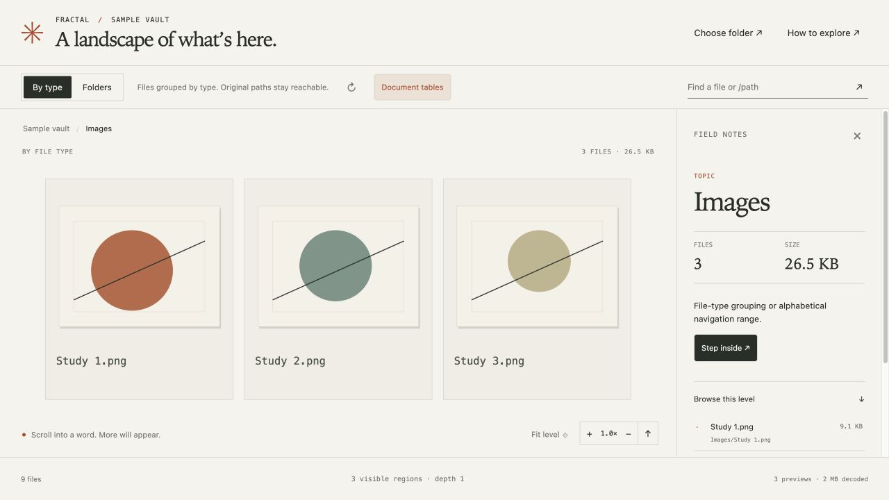

# Fractal

**Your folders, unfolding.** A local, zoomable landscape of folders and documents.

Choose a folder, drive or vault. Big words unfold into smaller words, folders and files. Zoom closer and real document previews resolve into view. Everything runs on your computer.



Fractal is a small local web app: Python serves the data, SVG draws the map, and your browser is the interface. No account, cloud upload, telemetry or remote image service.

## Start

Requires **Python 3.11 or later**. From a Terminal:

```sh
git clone https://github.com/MattaDurham/fractal.git
cd fractal
python3 -m venv .venv
. .venv/bin/activate
python -m pip install -e .
fractal
```

On macOS, you can also double-click **start.command**. On first use it creates a local virtual environment and installs the Python dependencies from PyPI, then opens the app. Later launches reuse it. A working Python 3.11+ installation is required.

On Windows, create the environment with `py -m venv .venv`, then run `.venv\Scripts\python -m pip install -e .` and `.venv\Scripts\fractal`.

Fractal opens at **http://127.0.0.1:8769**. Keep the terminal running; Ctrl-C stops the server. Closing the browser does not erase your saved collections. After a restart, launch Fractal again.

```sh
fractal --folder "/path/to/a/vault"
fractal --data-dir "/path/to/private/fractal-data" --port 8770
fractal --no-native
```

## Explore

- **Choose folder** opens the system folder picker. You can also enter a folder path. Previously selected folders appear in your local saved list.
- **Folders** follows the directory tree. **By type** groups files by extension. It does not claim an AI reading of your documents.
- Scroll toward a word to zoom, drag to pan, click for details, double-click to enter or inspect. Keyboard: +/− zoom, arrows pan, 0 fits, Escape goes up, Home returns to the collection. **Browse this level** provides equivalent buttons.
- **Document tables** shows actual cached previews at file level. PDFs can unfold into page spreads. **Rescan folder** refreshes metadata after changes.
- **Explore an example** creates a small synthetic collection. **Import a dataset** accepts a versioned JSON folder tree with optional descriptions, topics and preview images. A format example is included in `fractal/web/example.json`.

The map is SVG; document pixels are raster previews layered into it. There is one rendering mode. Offscreen regions are culled, sibling lists are bounded with navigable alphabetical ranges, and preview quality increases with zoom.

## Local data and previews

Selected folders are **read-only**. Inventory scans record names, paths, sizes, dates and file types. They do not execute scripts, launch selected applications, modify originals, compute whole-drive hashes or read every document body. File bodies are read when generating supported previews. Symlinks are listed but not followed; hidden files are opt-in.

Saved collection paths, inventories, source-access receipts and derivative previews live separately:

| Platform | Default data directory |
| --- | --- |
| macOS | `~/Library/Application Support/Fractal` |
| Linux | `$XDG_DATA_HOME/fractal` or `~/.local/share/fractal` |
| Windows | `%LOCALAPPDATA%\Fractal` |

These are private runtime files, outside the source repository. Forgetting a saved collection removes its list entry; source files remain unchanged. Use `--data-dir` to choose a different location. The app binds only to loopback, checks Host/Origin, and requires a local session token for changes and the folder picker. It is designed as a single-user local app, not an internet-facing server.

Pillow renders images and bounded text excerpts; PDFium/pypdfium2 renders PDFs in separate processes. On macOS, optional native helpers use Core Graphics, Image I/O and Quick Look for additional formats and Office content thumbnails. Helpers compile into the private data directory when Apple command-line tools are present. Without them, portable image/PDF/text previews still work. The folder path field works when a native picker is unavailable; non-Mac native dialogs also need Tkinter.

One preview worker per opened collection generates only requested tiers/tiles. A shared write lock serializes persistent writes. Retained visible images share a 16-million-pixel budget; source decodes can use additional temporary memory. Derivative images have a 2 GB budget per collection and regenerate after eviction. Image inspection is capped at 8,192 pixels on the long edge; PDFs render at 2 pixels per point. Preview access receipts remain outside the image budget.

## Scope

This is an early, usable project. Counts are preliminary during indexing. Inaccessible entries are reported; rescan after reconnecting an unavailable drive. Excel/Office previews depend on installed macOS providers and are content thumbnails, not complete sheet/tab or page browsers. Unsupported formats keep their path and an explicit unavailable state. Text previews show the first 64 KiB / 60 lines. Known credential filename patterns and credential-like text are withheld, but Fractal is not a secret-auditing tool.

Collections and caches are local. JSON imports are browser-session imports; keep the JSON file to reopen them. There is no filesystem watcher, cloud synchronization, automatic semantic clustering or standalone signed desktop bundle yet. Different storage systems can implement the same small read-only node/children/details/search contract without changing the renderer.

## Develop

```sh
python -m unittest discover -s tests -v
node tests/test_layout.cjs
node tests/test_dataset.cjs
node tests/test_preview_stability.cjs
```

Python tests use synthetic files only. They cover source immutability, Unicode, saved collections, refresh identity, hidden files, ranges, search, symlink containment, private-state isolation, preview fidelity and local HTTP boundaries. JavaScript checks cover layout/camera behavior, imports and the visible-thumbnail cache regression. CI runs the portable Python suite on Linux, macOS and Windows.

See [architecture](docs/architecture.md) and [third-party notices](THIRD_PARTY.md). MIT licensed; OpenSeadragon retains its BSD-3-Clause license.
